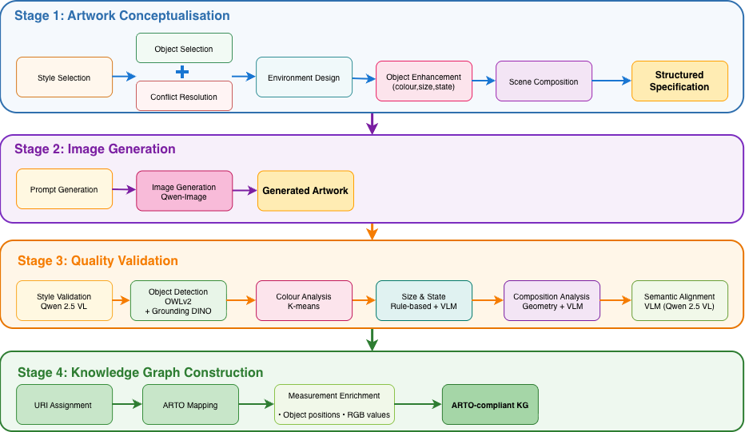

# ARTO-KG: A Synthetic Artwork Dataset for Knowledge-Enhanced Understanding

ARTO-KG is a large-scale synthetic artwork dataset that bridges visual content and structured knowledge through ontology-informed automated generation. Each artwork is annotated with an ARTO-compliant RDF knowledge graph, where ARTO is the Artwork Object Ontology (http://w3id.org/arto).

The complete ARTO-KG dataset (10,108 artworks with images, structured specifications, and RDF knowledge graphs) is available on Hugging Face: [youngcan1/ARTO-Gen-Dataset](https://huggingface.co/datasets/youngcan1/ARTO-Gen-Dataset)

---

## Dataset Overview

ARTO-KG contains 10,108 high-resolution artworks across five artistic styles, each paired with rich semantic annotations.

### Statistics

- Total Artworks: 10,108
- Object Instances: 39,878 (average 3.95 per artwork)
- RDF Triples: 1,056,970 (average 104.6 per artwork)
- Spatial Relations: 33,579 (90.6% of all relations)
- Semantic Relations: 3,474 (9.4% of all relations)
- Artistic Styles: 5 (Baroque, Impressionism, Post-Impressionism, Neoclassicism, Chinese Ink)

### Style Distribution

| Style | Count | Key Characteristics |
|-------|-------|---------------------|
| Baroque | 2,000 | Dramatic lighting, indoor focus (89.5%) |
| Impressionism | 2,003 | Light and colour emphasis, mostly indoor scenes (71.2%) |
| Post-Impressionism | 2,001 | Expressive brushwork, most watching (436) and holding (245) relations |
| Neoclassicism | 2,104 | Classical compositions, formal arrangements |
| Chinese Ink | 2,000 | Landscape-oriented; highest shares of morning (54.4%), cloudy (37.1%) and outdoor (39.0%) settings |

## Key Features

**Structured Knowledge Representation**

Existing artwork datasets primarily provide high-level metadata such as artist names, style labels, and genre classifications, lacking fine-grained visual semantics essential for compositional understanding and semantic reasoning. Collections such as Art500K and WikiArt provide categorical labels, while SemArt offers natural language descriptions that remain unstructured. ARTO-KG provides fine-grained, machine-readable representations of depicted visual content, spanning visual elements, objects, scenes, and their relationships. Each artwork's knowledge graph records:

- **Visual Elements**: Colours with RGB values
- **Objects**: Bounding boxes, relative sizes, physical states, materials linked to the Getty AAT
- **Spatial Relations**: Geometric layouts (left_of, on, behind, beside, etc.)
- **Semantic Relations**: Meaningful interactions (holding, watching, playing_with, etc.)

This hierarchical representation spans from low-level visual elements to high-level scene semantics. Among the compared datasets, ArtGraph also provides a knowledge graph representation, but focuses on artwork metadata.

**Ontology-Informed Generation**

Our automated framework leverages the ARTO ontology to ensure:
- Schema Consistency: 100% ARTO-compliant RDF triples
- Semantic Richness: Average 104.6 triples per artwork

**Multi-Dimensional Quality Validation**

Each artwork undergoes comprehensive validation:
- Style Accuracy: 92.8% (manual verification)
- Object Presence: 98.4% (manual verification)
- Overall Quality: 78.2% mean score across the 5 automatically scored dimensions (colour, size, state, relations, alignment)


## Installation

Requirements:
- Python 3.9-3.11
- CUDA-capable GPU

```bash
git clone https://github.com/SocialMachineLab/ARTO-Gen-Dataset.git
cd ARTO-Gen-Dataset
pip install -r requirements.txt
```


## Usage

### Query the Knowledge Graph

```python
from rdflib import Graph

# Load an artwork's knowledge graph
g = Graph()
g.parse("ttl/ttl-split-1/artwork_20260103_022646_126.ttl", format="turtle")

# SPARQL query: Find all objects in the scene
query = """
PREFIX arto: <http://w3id.org/arto#>
PREFIX rdfs: <http://www.w3.org/2000/01/rdf-schema#>

SELECT ?object ?label WHERE {
    ?scene arto:containsObject ?object .
    ?object rdfs:label ?label .
}
"""

for row in g.query(query):
    print(f"Object: {row.label}")
```

### Generate New Artworks

The pipeline runs in four stages; each stage reads the output of the previous one.

```bash
# Stage 1: conceptualisation. Specifications are written to outputs/specs/final_results/.
# --num-objects is the maximum number of secondary objects (ARTO-KG uses 8).
# Add --style "Impressionism" to set the style; otherwise one of the five styles is sampled.
python -m arto_kg.conceptualization.main \
    --count 10 \
    --num-objects 8 \
    --output-dir outputs/specs

# Stage 2: image generation (Qwen-Image, 1024x1024)
python -m arto_kg.generation.main \
    --input-dir outputs/specs/final_results \
    --output-dir outputs/images
```

### Validate Generated Artworks

```bash
# vLLM reads local images only under this path
export VLLM_MEDIA_PATH=$(pwd)

# Stage 3: validation. Detections not found in --od-dir are computed and saved there.
python -m arto_kg.validation.main \
    --input-dir outputs/specs/final_results \
    --image-dir outputs/images \
    --od-dir outputs/detections \
    --output-dir outputs/validation
```

### Build the Knowledge Graph

```bash
# Stage 4: one Turtle file per artwork
python -m arto_kg.knowledge_graph.run_kg_assembly \
    --input_dir outputs/specs/final_results \
    --od_dir outputs/detections \
    --val_dir outputs/validation \
    --output_dir outputs/ttl
```

## Repository Structure

```
ARTO-Gen-Dataset/
|-- arto_kg/                      # Core package
|   |-- conceptualization/        # Artwork design (LLM-based)
|   |   |-- object_selector.py    # COCO-based object selection
|   |   |-- scene_composer.py     # Spatial & semantic relations
|   |   |-- environment_designer.py # Lighting, weather, atmosphere
|   |   |-- object_enhancer.py    # Object attributes
|   |   |-- prompt_generator.py   # Image generation prompts
|   |-- generation/               # Image generation
|   |   |-- main.py               # Qwen-Image integration
|   |-- validation/               # Quality assurance
|   |   |-- batch_processor.py    # Multi-step validation
|   |   |-- validators/           # Specialised validators
|   |-- knowledge_graph/          # RDF generation
|   |   |-- run_kg_assembly.py    # JSON to TTL converter
|   |   |-- arto_mapper.py        # ARTO ontology mapping
|   |-- config/                   # Configuration files
|-- experiments/                  # Research experiments
|   |-- multimodel_generation/    # Multi-model comparison experiments
|   |-- object_detection/         # Object detector selection
|   |-- style_feature_analysis/   # Artistic style selection
```

## Generation Framework


*Figure: Overview of the ontology-informed artwork generation pipeline, from Artwork Conceptualisation to RDF Knowledge Graph Construction.*

Our automated pipeline consists of four main stages:

**Stage 1: Artwork Conceptualisation**

An LLM (gpt-oss-120b) builds a structured specification in six steps:

1. Style Selection: one of the five styles, which stays fixed and guides the later steps.
2. Object Selection: one primary COCO category and up to eight secondary ones, drawn from a two-layer vocabulary that maps COCO categories to WikiArt-derived, style-specific varieties (e.g. "person" may become "bishop", "gardener" or "ballet dancer").
3. Conflict Resolution: pairwise compatibility checks remove conflicting objects while keeping the primary object; the LLM then proposes 5-10 candidate scenarios for the remaining objects and one is chosen at random. If no plausible scenario is found, a new object set is sampled.
4. Environment Design: place (Places365 categories), weather (WMO categories), historical period (Ancient, Post-classical, Early modern, Modern, Contemporary), time of day, lighting, and colour scheme.
5. Object Enhancement: size, state, primary colour, and material for each object, chosen in the context of the environment.
6. Scene Composition: spatial relations (left_of, on, behind, beside, etc.) and semantic relations (holding, watching, playing_with, etc.), from a vocabulary derived from Visual Genome and GQA.

- Performance: ~3.2 min per artwork on NVIDIA A100

**Stage 2: Image Generation**

- Prompt: the structured specification is compiled into three prompt formats (comma-separated keywords, a single descriptive sentence, and a detailed description); ARTO-KG uses the detailed description
- Model: Qwen-Image (1024x1024 resolution, 80 inference steps)
- Performance: ~0.5 min per artwork on NVIDIA A100

**Stage 3: Quality Validation**

Each generated image is checked against its specification. The detected object locations and representative RGB values are kept as image-derived measurements for Stage 4.

| Validator | Method | Result |
|-----------|--------|--------|
| Style | Qwen2.5-VL-32B zero-shot classification | 92.8% (manual check) |
| Object Detection | OWLv2 + Grounding DINO, text-guided localisation of each specified object | 98.4% (manual check) |
| Colour | K-means dominant colours compared in CIELAB (Delta E), per object and for the whole image | 51.1% |
| Size | Bounding-box areas compared with the size categories (Dominant, Large, Medium, Small, Marginal) | 71.5% |
| State | Qwen2.5-VL-32B | 89.2% |
| Relations | Spatial: bounding-box geometry (IoU, centre position, distance); semantic: Qwen2.5-VL-32B | 89.8% |
| Alignment | Qwen2.5-VL-32B: content coverage, semantic similarity, overall alignment | 89.6% |

- Performance: ~1.2 min per artwork on NVIDIA A100

**Stage 4: Knowledge Graph Construction**

1. URI Assignment: unique URIs for the artwork, its scene, objects, and visual elements.
2. ARTO Mapping: the specification's entities, attributes, and relations become RDF triples using ARTO classes and properties; concepts link to Wikidata and the Getty AAT.
3. Measurement Enrichment: detected object locations and representative RGB values from Stage 3 are added.

- Format: RDF/Turtle (TTL), one file per artwork
- Performance: ~0.1 min per artwork

## Example: Generation Walkthrough

Input: a table as the primary object, together with a lamb, iris, wine bottle, and lamp post as secondary objects (Post-Impressionism style)

**Step 1 - Conflict Resolution**

The table, lamb, iris, wine bottle, and lamp post are all retained. The LLM proposes 5-10 candidate scenarios containing the complete object set, and "artistic courtyard" is randomly selected from them.

**Step 2 - Environment Design**

The "artistic courtyard" scenario is further specified as a courtyard under cloudy weather, in the Modern period, at sunset, with mixed lighting and warm colour tones.

**Step 3 - Object Enhancement**

The objects are characterised with context-dependent attributes: a violet iris, a green glass wine bottle, a woolly white lamb, a dark bronze lamp post, and a golden ochre wooden table.

**Step 4 - Scene Composition**

```json
{
  "spatial_relations": [
    {"subject": "wine_bottle", "relation": "on", "object": "table"},
    {"subject": "lamb", "relation": "beside", "object": "table"},
    {"subject": "lamp_post", "relation": "behind", "object": "table"},
    {"subject": "iris", "relation": "beside", "object": "table"}
  ]
}
```

**Step 5 - RDF Output**

```turtle
:lamb rdf:type arto:Object , owl:NamedIndividual , :Sheep ;
    rdfs:label "Lamb"@en ;
    arto:hasSize :MediumSize ;
    arto:state [ a skos:Concept ; rdfs:label "Peaceful, still posture"@en ] ;
    arto:beside :table .
:wine_bottle arto:on :table .
:lamp_post arto:behind :table .
:iris arto:beside :table .
```

## Applications

ARTO-KG's structured knowledge representation enables a wide range of research applications across multiple domains. The dataset's comprehensive RDF annotations support tasks requiring deep compositional understanding, including scene graph generation, object relationship detection, and visual semantic reasoning. For multimodal AI research, the dataset bridges visual content and structured knowledge, supporting artwork captioning, visual question answering, and cross-modal understanding. In digital humanities, the ARTO-compliant annotations enable computational analysis and digital curation of artistic content.

**Scene Graph Generation**

The dataset contains 37,053 object relationships (90.6% spatial, 9.4% semantic) with complexity ranging from simple scenes with 1-3 objects (49.2%) to complex compositions with 7+ objects (17.6%).

**Semantic Retrieval**

SPARQL-based queries achieve better precision compared to 46% (CLIP) and 53% (text retrieval):

```sparql
# Find Baroque paintings with a person holding a book
PREFIX arto: <http://w3id.org/arto#>
PREFIX aat: <http://vocab.getty.edu/aat/>
PREFIX dcterms: <http://purl.org/dc/terms/>

SELECT ?artwork ?title WHERE {
    ?artwork arto:style aat:300021147 ;    # Baroque (Getty AAT)
             dcterms:title ?title ;
             arto:containsScene ?scene .
    ?scene arto:containsObject ?person, ?book .
    ?person arto:cocoCategory "person" ;
            arto:holding ?book .
    ?book arto:cocoCategory "book" .
}
```

**Data Augmentation**

The framework can generate rare style-object combinations to address long-tail distribution problems in real artwork datasets, providing controllable evaluation of compositional understanding.

## Dataset Comparison

| Dataset | Size | Annotation Type | Triples/Image |
|---------|------|----------------|---------------|
| Art500k | 500k | Style/Artist Labels | - |
| OmniArt | 2M | Metadata + IconClass | - |
| ArtGraph | 116k | Metadata KG | 7.5 |
| WikiArt | 80k | Style/Genre | - |
| SemArt | 21k | Captions + Metadata | - |
| DEArt | 15k | Bounding Boxes | - |
| ARTO-KG | 10k | Visual Content RDF | 104.6 |

## Configuration

### Environment Variables

```bash
# VLM media access path (for validation)
export VLLM_MEDIA_PATH=/path/to/ARTO-Gen-Dataset

# Optional: validation VLM (the generation LLM is set in arto_kg/config/model_config.py)
export VALIDATION_VLM="Qwen/Qwen2.5-VL-32B-Instruct-AWQ"
```


### Hardware Requirements

| Task              | GPU          | VRAM  | CPU RAM |
| ------------------- | -------------- | ------- | --------- |
| Conceptualisation | Required     | ~80GB | 32GB    |
| Image Generation  | Required     | ~60GB | 32GB    |
| Validation        | Required     | ~40GB | 32GB    |
| KG Assembly       | Not required | -     | 8GB     |

## License

This project is licensed under the MIT License - see the LICENSE file for details.

## Related Resources

- **Dataset**: [Hugging Face - youngcan1/ARTO-Gen-Dataset](https://huggingface.co/datasets/youngcan1/ARTO-Gen-Dataset)
- **ARTO Ontology**: http://w3id.org/arto

## Contact

Maintained by Social Machine Lab, Australian National University

Email: Can.Yang@anu.edu.au
