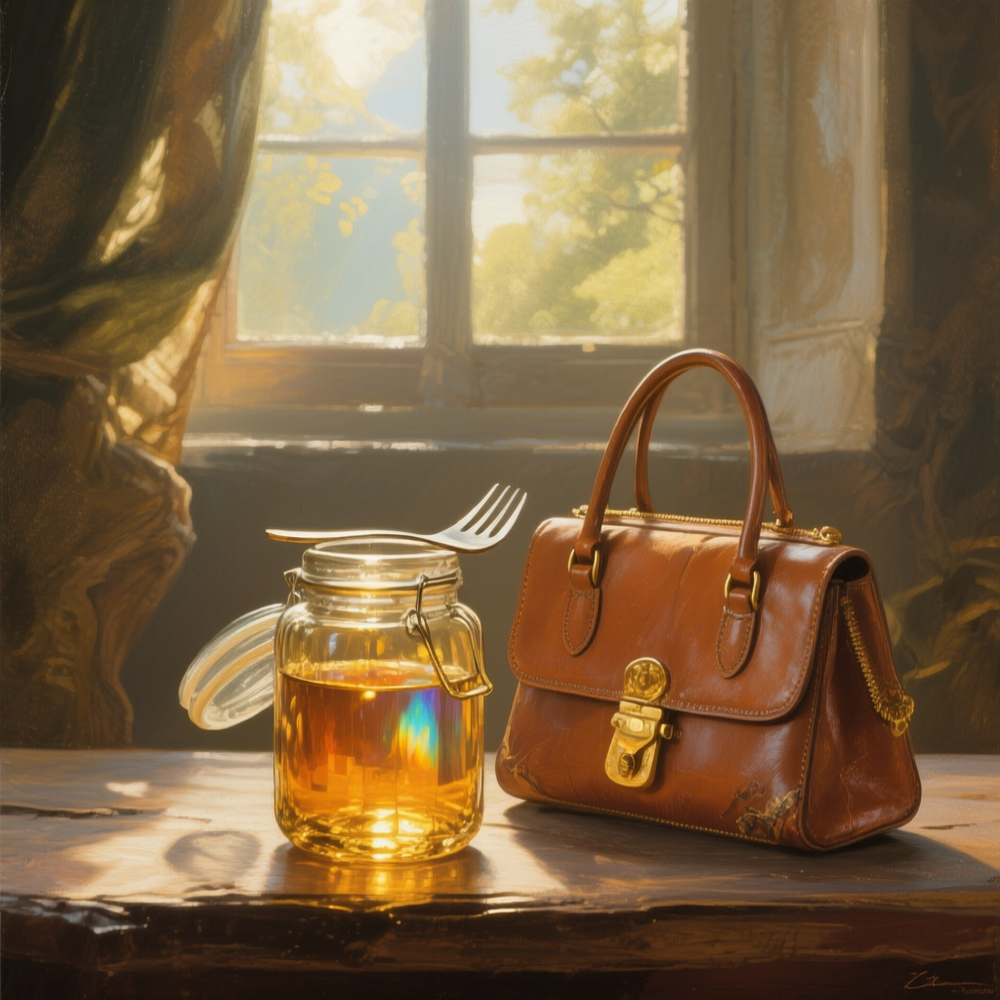
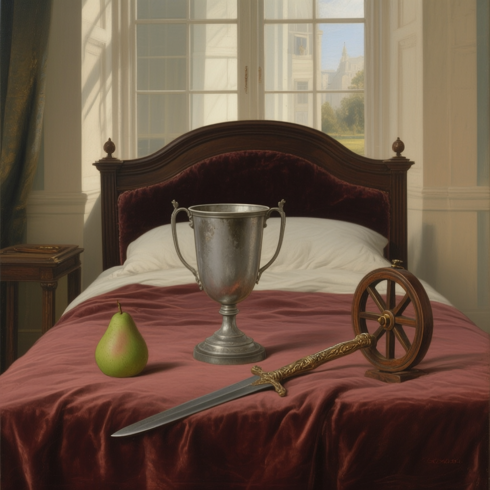
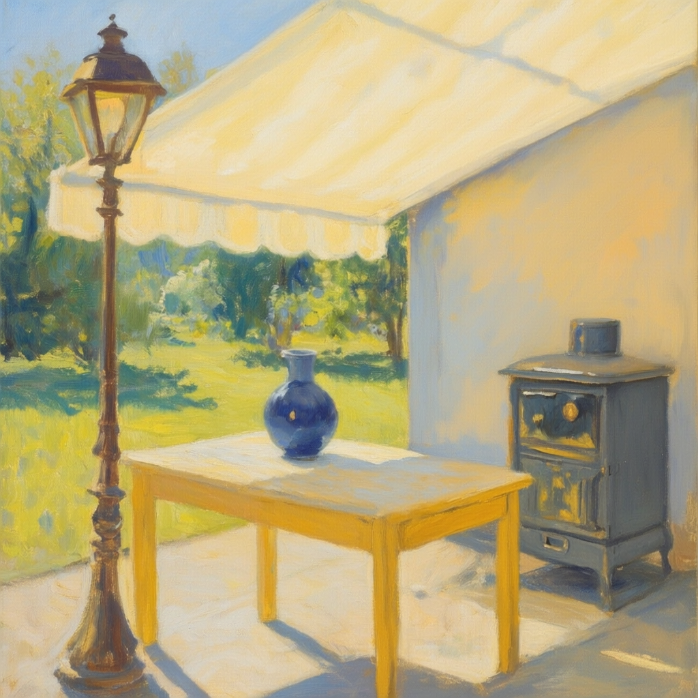
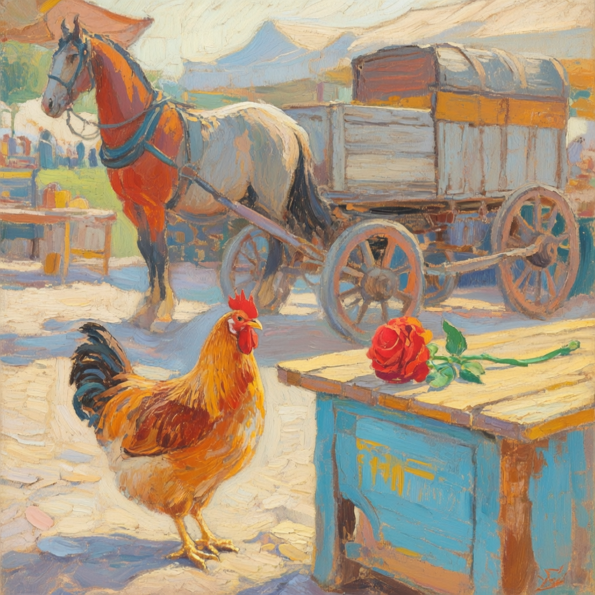
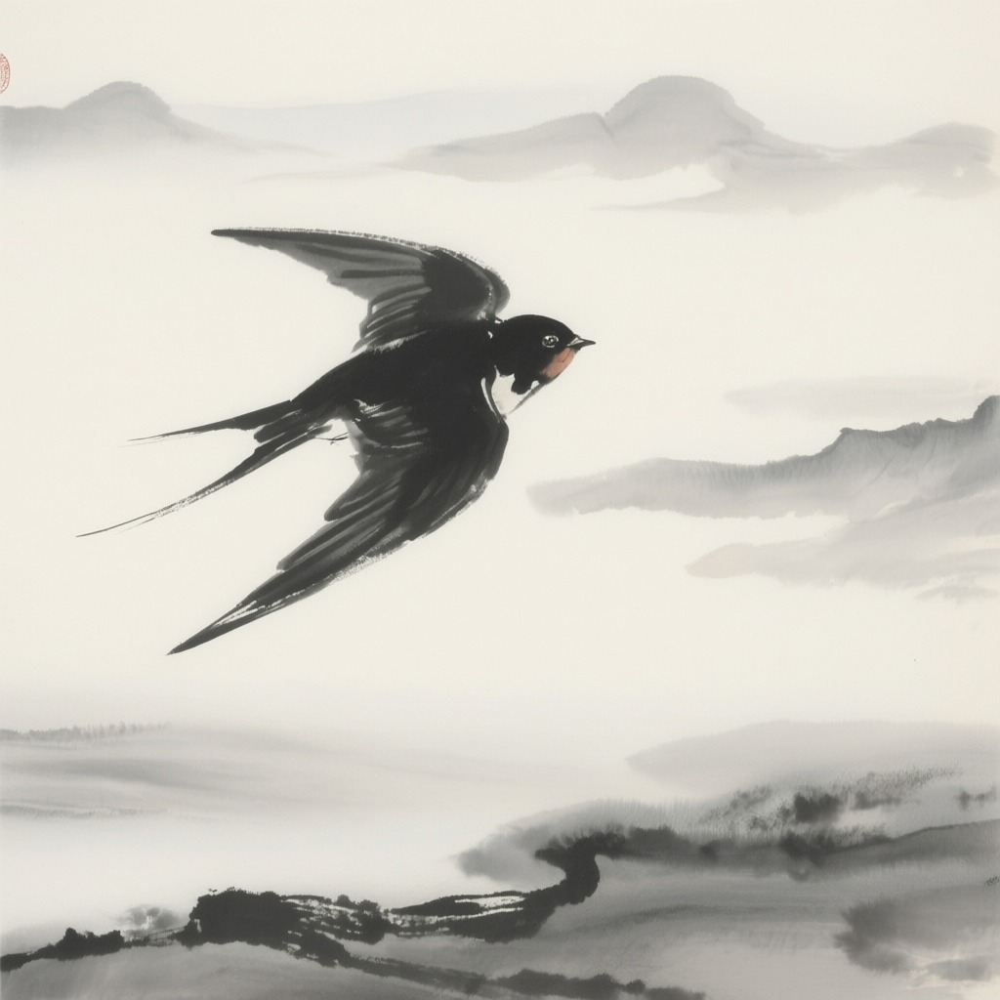

# Examples

The examples below show generated artwork from each of the five artistic styles in ARTO-KG. Each example includes the generated image (`.png`), its generation specification (`.json`), and the corresponding knowledge graph (`.ttl`). The scene context, objects, and relations are extracted from the knowledge graph.
The full dataset is available on [Hugging Face](https://huggingface.co/datasets/youngcan1/ARTO-Gen-Dataset).

<table>
<tr>
<td></td>
<td>
<b>Baroque</b>  
<b>Scene:</b> kitchen, afternoon, sunny 
<b>Objects:</b> fork, glass jar, handbag 
<b>Relations:</b> fork on glass jar; handbag beside glass jar  
<a href="baroque/artwork_20260103_151301_825.json">Specification</a> | <a href="baroque/artwork_20260103_151301_825.ttl">Knowledge graph</a>
</td>
</tr>
<tr>
<td></td>
<td>
<b>Neoclassicism</b>  
<b>Scene:</b> bedroom, afternoon, cloudy 
<b>Objects:</b> bed, trophy cup, pear, dagger, wheel 
<b>Relations:</b> trophy cup on bed; pear on bed; dagger on bed; wheel on bed  
<a href="neoclassicism/artwork_20260104_013158_608.json">Specification</a> | <a href="neoclassicism/artwork_20260104_013158_608.ttl">Knowledge graph</a>
</td>
</tr>
<tr>
<td></td>
<td>
<b>Impressionism</b>  
<b>Scene:</b> courtyard, afternoon, sunny 
<b>Objects:</b> sunshade, vase, lamp post, table, stove 
<b>Relations:</b> table under sunshade; vase on table; lamp post beside table; stove beside table  
<a href="impressionism/artwork_20260103_173226_943.json">Specification</a> | <a href="impressionism/artwork_20260103_173226_943.ttl">Knowledge graph</a>
</td>
</tr>
<tr>
<td></td>
<td>
<b>Post-Impressionism</b>  
<b>Scene:</b> outdoor market, morning, sunny 
<b>Objects:</b> hen, horse cart, stand, rose 
<b>Relations:</b> hen beside stand; horse cart behind stand; rose on stand  
<a href="post_impressionism/artwork_20260103_022659_722.json">Specification</a> | <a href="post_impressionism/artwork_20260103_022659_722.ttl">Knowledge graph</a>
</td>
</tr>
<tr>
<td></td>
<td>
<b>Chinese Ink</b>  
<b>Scene:</b> valley, morning, cloudy 
<b>Objects:</b> swallow  
<a href="chinese_ink/artwork_20260103_182856_835.json">Specification</a> | <a href="chinese_ink/artwork_20260103_182856_835.ttl">Knowledge graph</a>
</td>
</tr>
</table>
